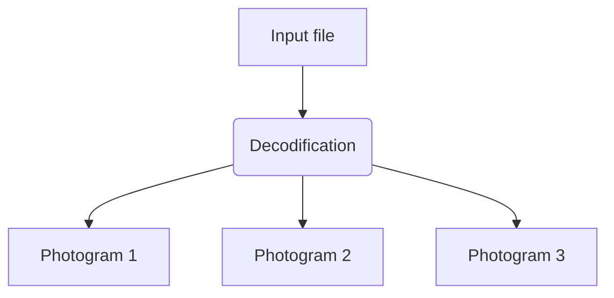

---
infobox:
  title: Commodiesel Video Encoder
  fields:
    - section: Info
    - Created by: ElGrue
    - Written in: Python
    - First developed in: Nov 2025
  subtitle: GIF, Video and Image converter
  images:
    - label: ""
      image: Assets/Commo test.gif
      caption: Video test being played in the Commodiesel's screen.
---
<div style="display:flex;align-items:center;gap:10px;
    margin:10px 5px 5px 5px;
    padding:0; 
    overflow:visible;
    font-family:sans-serif;
    font-size:1.05rem;
    color:#FFFFFF;
    text-shadow:0 2px 6px rgba(0,0,0,1),0 3px 6px rgba(0,0,0,0.23);
    border-radius:0.5px;
    border:2px solid #777777;
    box-shadow:2px 2px #777777;
    background:none;">
    <div style="display:flex;align-items:center;gap:10px;
        height:80px;
        border-radius:0.5px;
        background:
            linear-gradient(to bottom,rgba(238,220,52,0.85),rgba(15,16,1,0.85)),
            repeating-linear-gradient(-45deg,#ced211,#ced211 20px,#010100 20px,#010100 40px);
        flex-grow:1;
        overflow:visible;">
        <div style="position:relative;width:120px;height:120px;flex-shrink:0;display:flex;align-items:center;justify-content:center;">
            
        </div>
        <div style="display:flex;flex-direction:column;justify-content:center;">
            <div style="font-size:2rem;color:#ffffff;">
                <span style="color:#ced211;">WORK</span>
                <span style="color:#010100;">IN</span>
                <span style="color:#ced211;">PROGRESS!</span>
            </div>
            <div style="font-size:1rem;color:#ffffff;font-style:italic;margin-top:4px;">
                I'm still working on this page... It might take a little while! Sorry.
            </div>
        </div>
    </div>
</div>

## Introduction

The Commodiesel Video Encoder is a personal project that I've been developing for almost a year now. It's one of the most complex, intricate and, personally, the project I am most proud of.
In a nutshell, it is a [Python](https://en.wikipedia.org/wiki/Python_(programming_language)) program where you input any [Video](https://en.wikipedia.org/wiki/Video_file_format), [GIF](https://en.wikipedia.org/wiki/GIF), or [Image](https://en.wikipedia.org/wiki/Image_file_format) file, and it'll output readable code for the [Commodiesel 75](https://crdg.xyz/computing/commodiesel-75). 

## Black Friday, 2025

On the 2025 [Black Friday](https://en.wikipedia.org/wiki/Black_Friday_(shopping)) in [CRDG](https://www.roblox.com/games/7715234692/cart-ride-around-a-75-KW-Diesel-Generator), the Miracle of Computing gamepass was put on sale for the game. Which let players get the Commodiesel 75. A computer that ran [Lua](https://en.wikipedia.org/wiki/Lua) code, and ran it on the game. It was a really revolutionary thing, back then. And as the *Commited* Cart Rider I am, I rushed to buy it! And started tinkering with it. The good thing is that I already had a bit of knowledge in Lua coding.

## The idea

It didn't take long for people to start creating incredible programs in the Commodiesel.
And one day, I found what seemed to be impossible at the time. In a public server, someone had been playing a [Markiplier](https://en.wikipedia.org/wiki/Markiplier) video on the Commodiesel. I was completely astonished! It was incredible! A computer that had tons of limitations, and was seemingly impossibl to run a video on, had one running! I couldn't sleep that night, and talked about it with [[My Sister]], who told me to try to make it.


---

# First Versions

## First steps towards the Image Encoding.

I knew that making an encoder for the Commodiesel wasn't going to be an easy task. I had very little experience in Lua, and barely enough knowledge of Python. But I was [determined](https://en.wikipedia.org/wiki/Determination) to make it. So I decided to start with a simpler task: Image Encoding

My first approach was simple. Make a Python program that analized an inputed image with [OpenCV](https://en.wikipedia.org/wiki/OpenCV) (For most video formats like [MP4](https://en.wikipedia.org/wiki/MP4_file_format) or [MKV](https://en.wikipedia.org/wiki/Matroska)) to then resize it and output Many textures, which at that time where little squares because of the Commodiesel Sprite Size limitation, then displayed them on the screen. It seemed to be a decent idea, but I soon ran into troubles..

>[!warning] Before you try to kill me!
>As much as I'd love to put little bits of the first versions of the code, I hate to say that I've lost the code as I scrapped it soon after I couldn't really fix it.

## First... Troubles?

It was to be expected for my first encoder to have many troubles. And *oh, boy* did this one have troubles...

The first and most notable (and, honestly, the most hilarious one) was that the way that I used to read colors from the image was **so** messed up... I somehow made it have the colors all messed up!

![[Captura_de_pantalla_2025-12-05_165247.png]]
*Ralsei looking really sad, and really bad on the first versions of the encoder.*

You can also notice how it *generated little squares* to make the full image. For some reason, the sprite genertion itself *failed too!* You already can tell just how bad it was..!

Alas, poor macica... I gave up for a while a bit after trying to create the first versions of the encoder. I was just starting out, and I didn't reallly think I would make it work.


---

# The pursuit of the Image Encoding

After while, I felt empty, I really wanted to make it work! But I was really upset... Until...
Something truly revolutionary happened!

## Commodiesel Image Encoder

I was cooking some food, when I recieved a call from my one and only sister! And she had incredible news! She, somehow, got the output from another player's Image encoder!

>[!info] Quick Notice
>I do not know who had that image encoder, or who did it. But I want to thank them for their work, because without it, this whole project would've just been another idea in my mind.
>(Also, I'd like to thank my sister, even though she basically just stole someone's code.)

The output was something like this: 

```lua
-- Illustrative output (very simplified)

local imageData = {
    width = 4,
    height = 3,

    pixels = {
        12, 12, 24, 24,
        12, 48, 48, 24,
        36, 36, 24, 24
    }
}

-- [Rendering implementation omitted]
```

>[!info] 
> Basically, each number represents a color index, in this example, the image is a 4 x 3, whose information are saved in a Lua table.

Now, I needed to figure out *How the heck does one get an image to become that?*
So I started simple. First, I'd read the image. That'd look something like this:

```python
from PIL import Image

image = Image.open("image.png").convert("RGB")

width, height = image.size
pixels = list(image.getdata())

# Color conversion omitted
```

>[!info]
> Here, the encoder opens the image, and obtains the RGB values of its pixels.

Let's imagine this:
We have an image that's only six pixels:

![[img example.png]]
*Example image with only three colors*

Internally, the pixels would look something like this:

```
(255, 0, 0)   (0, 255, 0)   (0, 0, 255)
(0, 0, 255)   (255, 0, 0)   (0, 255, 0)
```

Later, the encoder converts each RGB color into an index compatible with the Commodiesel's color palette.

For purposes of the example, let's assign these values:
- Red = 1
- Green = 2
-  Blue = 3

Once the pixels are converted, Python can write their values into a text file.
That'd look something like this:

```python
# Simplified output generation

with open("image.lua", "w") as output:
    output.write("-- Encoded image\n")
    output.write("local pixels = {1,2,3,3,1,2}\n")

# Additional rendering code omitted
```

Then, the output would be something similar to this:

~~~lua
-- Encoded image (illustrative)

local image = {
    width = 3,
    height = 2,
    pixels = {1, 2, 3, 3, 1, 2}
}

-- [Rendering implementation omitted]
~~~

And that's it! The values no longer represent the original RGB colors, but index values that can be read by the decoder.

The position of each pixel on the list is determined by its coordinates. For an image stored by rows, the usual formula is:

$$
i=y\cdot W+x
$$
Where $W$ is the width of the image and the coordinates start at zero.

But, wait a second. We are supposed to make a video encoder, aren't we?
Well, that's what the next part is about!


---

# Commodiesel Video Encoder - First Generation

The first ever video encoder that I made was this one. And I'm really proud of it! It's been a project that has thought me a lot about both Python and Lua! Anyways, let's get into it!

## Introduction to the Video Encoder

The First Generation of the Commodiesel Video Encoder was meant to take in video files or GIF files, and convert them into readable text for the Commodiesel 75.

It's architecture was based on a *relatively* simple principle: convert each photogram to a compatible representation with the Commodiesel, identify the modified regions and update the existing sprites.

>[!tip] Interesting Difference
>In contrast to the Second Generation, this version directly modified the textures that were being shown in the screen.
>This had major consequences in the performance...

## Part I - Processing the video

### 1. Decoding the original file

When you select the video file, the encoder detects what file format it is, and uses the corresponding library for each one. (GIF files get processed by Pillow, other video files get processed by OpenCV).

And then the file would get converted into a digital image sequence.
That would look something like this:




An example in python would be something similar to this:

```python
# Example

import cv2

capture = cv2.VideoCapture("video.mp4")

success, image = capture.read()

if success:
    height, width = image.shape[:2]
    print("Image dimensions:", width, height)

capture.release()
```

### 2. Reducing the resolution

The first version of the encoder worked with images with a resolution of 100x82 pixels.
Each photogram needed to adapt to these dimensions before getting converted into compatible colors for the Commodiesel.
That operation is known as *spatial resizing*. Sounds *fancy*, right?
Here's an example!

```python
# Basic image resizing

target = (100, 82)

image = cv2.resize(
    image,
    target,
    interpolation=cv2.INTER_AREA
)
```

And that resizing was crucial! Since an HD image has about ***two million pixels***! That's about the population of [Slovenia](https://en.wikipedia.org/wiki/Slovenia)! And with the reduction, the total pixels would be just eighty-two hundred! That's a whopping 99.6% reduction of pixels!
...Anyways, enough of that. Let's get to the next part.

### 3. Temporal frame sampling

When processing animated GIFs or video files, the encoder needed to determine which frames should be retained.

A conventional video might run at 30 or 60 frames per second, whereas the Commodiesel's default target was *way* lower.

The interval between frames can be calculated using:

$$
\Delta t=\frac{1}{f}
$$
Where $f$ represents the framerate.
So! For 8 FPS, we'd do this:

$$
 \Delta t=\frac{1}{8}=0.125\text{ s} 
 $$
This means that each output frame represents approximately 125 milliseconds of playback!


---

## Part II - Any color you'd like

### 1. Color Quantization

Since the Commodiesel had a limited color palette of 256 colors, and a video can have up to 16.7 million possible colors! We can't just squeeze those in, sadly. So, the encoder had to approximate every single pixel to match the palette.

A general color-distance function can be represented as this:

$$
E=\alpha(R_1-R_2)^2+\beta(G_1-G_2)^2+\gamma(B_1-B_2)^2
$$

Where $\alpha$, $\beta$, and $\gamma$ represent weighting coefficients.
The purpose is to select a palette color that minimizes the difference from the original!

Here's a simplified example:

```python
# Educational color quantization example

def color_distance(a, b):
    return sum(
        (x - y) ** 2
        for x, y in zip(a, b)
    )

def nearest_color(pixel, palette):
    return min(
        palette,
        key=lambda candidate:
            color_distance(pixel, candidate)
    )
```


---

## Part III - Sprites, sprites, and more sprites

### 6. Detecting differences between frames

Once frames had been resized and converted to palette indices, the encoder compared their contents. The purpose was to identify which graphical regions changed between successive images.

This principle is known as *temporal differential encoding*!

A simplified change mask can be expressed as:

$$
D_t(x,y)= \begin{cases} 1 & I_t(x,y)\neq I_{t-1}(x,y)\\ 0 & I_t(x,y)=I_{t-1}(x,y) \end{cases}
$$

*A value of 1 indicates that a pixel has changed, while 0 indicates that it remains unchanged.*

The encoder could avoid storing unnecessary visual updates when consecutive frames were identical.

However, its principal export method operated primarily at the level of complete image strips rather than individual changed pixels.

This distinction had important consequences...

### 7. Vertical strip-based updates

So! The encoder basically, since a single sprite cannot cover the whole screen, it had to separate it into twelve strips which were eight strips wide. The final strip contained the remaining four pixels.

And then, if there was a change in a strip, then it'd mark it for updating. It would be something like this: 

~~~
For each strip:

    Compare its current contents
    with the previous frame

    If there is difference:
        Update this one!
~~~

This approach could reduce unnecessary updates when large areas remained unchanged.
However, even a small change inside a strip could require transferring the entire strip again... Which wasn't really good! And inneficient.

>[!info] Why was this inefficient?
>Because the graphical workload depended not only on how many pixels changed, but also on how widely those changes were distributed.
>\
>A single animated object affecting one or two strips could be relatively inexpensive.
>\
>However, visual noise, particles, camera movement, or fast animation could modify nearly every strip simultaneously.

## Part IV - Lua Output Generation

### 8. Serializing the visual information

After processing and comparing the frames, Python converted the resulting data into Lua-compatible structures.

This process is called *serialization*.

The first-generation export path primarily used numeric representations of image data.
A simplified example might look like this:

```lua
-- Illustrative encoded image

local image = {
    width = 4,
    height = 3,

    pixels = {
        12, 12, 24, 24,
        12, 48, 48, 24,
        36, 36, 24, 24
    }
}

-- Rendering implementation omitted
```

